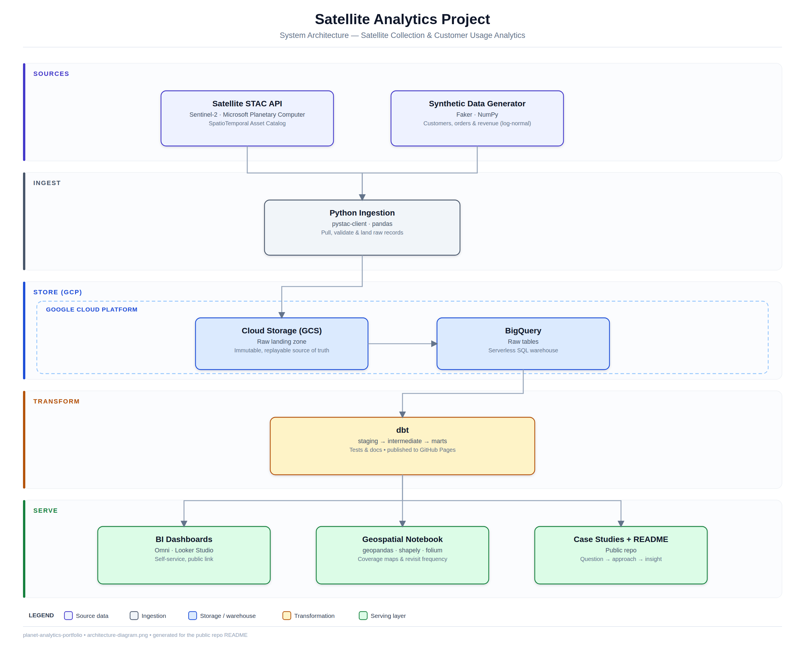

# Architecture

A deeper map than the README's [Architecture](../README.md#architecture) section:
what each stage does, how data flows between them, and where the contracts and
decisions live. The README answers *how do I use this*; this answers *how is it
put together and why*. Decision rationale lives in
[`decisions/`](decisions/); data contracts in
[`data_model.md`](data_model.md).

> **Status:** 🚧 Skeleton — sections are filled in as each stage is built. See
> the [README roadmap](../README.md#roadmap) for what currently exists.

---

## 1. Overview

<!-- 3–5 sentences: the shape of the whole system and the one idea that ties it
together (real supply + synthetic demand → warehouse → models → BI). What a
reader should hold in their head before the details below. -->

_TODO._

## 2. Data flow

End to end, stage by stage. Each stage names its **inputs**, **outputs**, **the
code that owns it**, and **how it's tested**.

### 2.1 Ingestion — `ingestion/`  ✅ partial

- **Real supply (STAC):** `pull_stac_metadata.py` → load AOIs → search →
  flatten → validate → write. Metadata only. _(Details: `CLAUDE.md` §Ingestion
  architecture.)_
- **Synthetic demand:** `generate_synthetic.py` — customers, AOIs, orders.
  _(Contract: `docs/data_model.md`.)_ <!-- TODO: not built yet -->
- **Landing:** <!-- TODO: GCS raw landing + BigQuery raw loaders (not built) -->
- **Outputs:** full pulls + reports → `data/raw/` (gitignored); committed
  sample → `data/raw_sample/`.
- **Tested by:** `ingestion/tests/` (pytest, no network).

### 2.2 Warehouse — GCS + BigQuery

<!-- Raw landing bucket, the `raw` and `satellite_analytics` datasets, location,
free-tier guardrails. Setup runbook: docs/gcp_setup.md. -->

_TODO._

### 2.3 Transformation — `dbt_project/`  ⬜ scaffolded

- **staging** → <!-- TODO: what it normalizes -->
- **intermediate** → `int_order_fulfillment` joins demand to supply (AOI ∩ scene
  footprint, time window, cloud threshold). _(Logic: `data_model.md`.)_
- **marts** → one per business question (Q1/Q2/Q3).
- **Tested by:** dbt schema tests + singular SQL tests.

### 2.4 Serving — BI + geospatial

<!-- Omni + Looker Studio dashboards (dashboards/); geospatial notebook
(notebooks/). Which business question each surface answers. -->

_TODO._

---

## 3. Components

| Component | Path | Responsibility | Status |
|---|---|---|---|
| STAC ingestion | `ingestion/` | Pull + validate real Sentinel-2 metadata | ✅ built |
| Synthetic generator | `ingestion/generate_synthetic.py` | Model demand (customers/AOIs/orders) | ⬜ TODO |
| Warehouse backend | GCS + BigQuery | Raw landing + warehouse | ✅ provisioned |
| dbt project | `dbt_project/` | staging → intermediate → marts | ⬜ scaffolded |
| BI layer | `dashboards/` | Self-service dashboards | ⬜ TODO |
| Geospatial notebook | `notebooks/` | Coverage / cloud / revisit analysis | ⬜ TODO |
| CI | `.github/workflows/` | pytest + dbt test on every push | ⬜ TODO |

---

## 4. Key contracts

The interfaces where a change in one place forces a change in another. Breaking
one of these is what breaks the pipeline.

- **STAC output schema** — `transform.COLUMNS` + dtype lists; grain is one row
  per `(item_id, region)`. _(`CLAUDE.md` §Ingestion architecture.)_
- **Synthetic ↔ real join** — AOI geometry ∩ scene footprint, time window,
  cloud threshold, resolved in dbt. _(`docs/data_model.md`.)_
- **Environment** — `.env` at repo root; see `.env.example` and `CLAUDE.md`
  §Environment for which vars ingestion vs. dbt read.
- <!-- TODO: BigQuery raw table schemas once loaders exist -->

---

## 5. Cross-cutting concerns

- **Testing** — per-layer, not just at the BI end. _(README §Testing.)_
- **Auth** — ADC only (`gcloud auth application-default login`), never a key
  file.
- **Reproducibility** — committed sample lets the project run without creds.
- **Cost** — free-tier BigQuery + GCS; guardrails in `docs/gcp_setup.md`.
- **Honesty** — synthetic vs. real is tracked explicitly so case-study claims
  stay defensible. _(`data_model.md` §1.)_

---

## 6. Design decisions

The *why* behind the above lives in [`docs/decisions/`](decisions/). Start
there to understand a choice; add an ADR when you make a new one.
